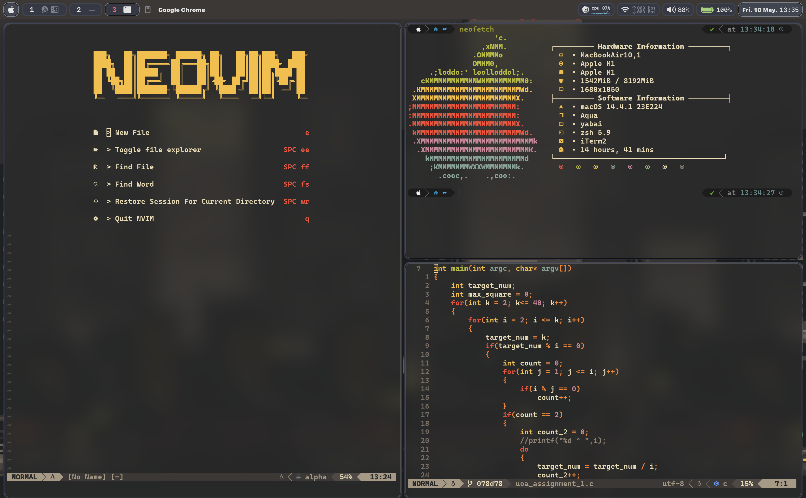
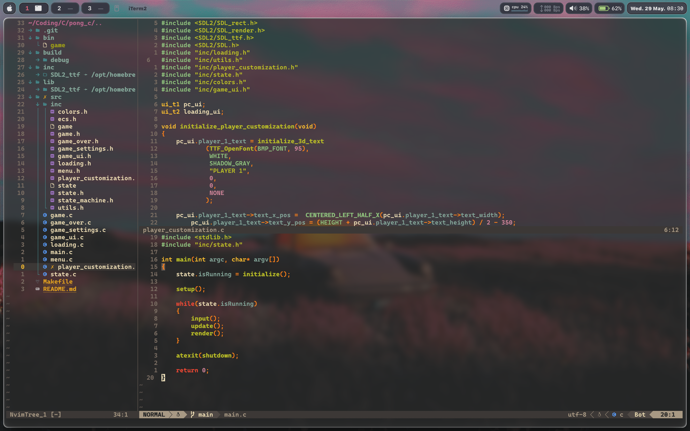
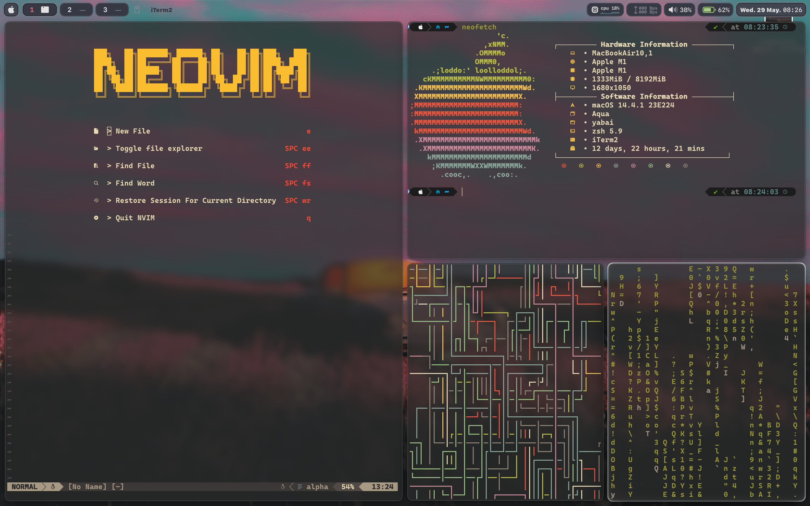

<div align="center">

# 🍂 My Dotfiles

**A keyboard-driven, Gruvbox-themed macOS setup**

tiling windows · custom status bar · Neovim IDE · tmux · kitty




</div>

---

## 📑 Contents

- [Overview](#-overview)
- [Window management: yabai + skhd + borders](#-window-management)
- [Status bar: SketchyBar](#-status-bar-sketchybar)
- [Editor: Neovim](#%EF%B8%8F-editor-neovim)
- [Terminal: kitty + tmux + fish](#-terminal)
- [Other tools](#-other-tools)
- [Installation](#-installation)
- [Gallery](#%EF%B8%8F-gallery)

---

## 🧭 Overview

| Component | Tool | Folder |
|---|---|---|
| Tiling window manager | [yabai](https://github.com/koekeishiya/yabai) | [`yabai/`](yabai) |
| Hotkey daemon | [skhd](https://github.com/koekeishiya/skhd) | [`skhd/`](skhd) |
| Window borders | [JankyBorders](https://github.com/FelixKratz/JankyBorders) | [`borders/`](borders) |
| Status bar | [SketchyBar](https://github.com/FelixKratz/SketchyBar) + [SbarLua](https://github.com/FelixKratz/SbarLua) | [`sketchybar/`](sketchybar) |
| Editor | [Neovim](https://neovim.io) | [`nvim/`](nvim) |
| Terminal emulator | [kitty](https://sw.kovidgoyal.net/kitty/) | [`kitty/`](kitty) |
| Multiplexer | [tmux](https://github.com/tmux/tmux) | [`tmux/`](tmux) |
| Shell | [fish](https://fishshell.com) | [`fish/`](fish) |
| File manager | [yazi](https://github.com/sxyazi/yazi) | [`yazi/`](yazi) |
| PDF viewer | [zathura](https://pwmt.org/projects/zathura/) | [`zathura/`](zathura) |
| System monitors | btop, htop, neofetch | [`btop/`](btop), [`htop/`](htop), [`neofetch/`](neofetch) |

**Font:** [IosevkaTerm Nerd Font](https://www.nerdfonts.com/) everywhere: terminal, bar and editor.
**Colors:** [Gruvbox Dark](https://github.com/morhetz/gruvbox) across every tool. The wallpaper is in [`wallpaper/`](wallpaper).

---

## 🪟 Window management

### yabai: [`yabai/yabairc`](yabai/yabairc)

- **BSP layout**. New windows open as the second child.
- **10px** gaps and padding all around.
- Mouse follows focus. `alt` + left drag moves a window, `alt` + right drag resizes it.
- Leaves room for the custom bar (`external_bar all:42:0`).
- Floats System Settings, Calculator, Finder and a few graphics/emulator dev windows.
- Helper scripts in [`yabai/bin/`](yabai/bin) move windows across spaces on newer macOS releases, without SIP disabled:
  - `move-to-space.sh`
  - `drag-to-space` (Swift)

### skhd: [`skhd/skhdrc`](skhd/skhdrc)

| Keys | Action |
|---|---|
| `cmd` + `h/j/k/l` | Focus window west/south/north/east |
| `shift` + `cmd` + `h/j/k/l` | Swap window |
| `ctrl` + `cmd` + `h/j/k/l` | Warp window |
| `shift` + `cmd` + `1…7` | Send window to space N |
| `shift` + `cmd` + `p` / `n` | Send window to previous / next space |
| `shift` + `cmd` + `m` | Toggle zoom-fullscreen |
| `shift` + `cmd` + `t` | Toggle float, centered on a grid |
| `shift` + `cmd` + `e` | Balance the space |
| `shift` + `cmd` + `r` | Rotate the layout 270° |
| `shift` + `cmd` + `x` / `y` | Mirror the layout on the x / y axis |
| `cmd` + `x` | Close window |
| `ctrl` + `cmd` + `s` / `q` / `r` | Start / stop / restart yabai |

### borders: [`borders/bordersrc`](borders/bordersrc)

- Rounded 2px borders.
- **Yellow** (`#fabd2f`) on the focused window, grey (`#3c3836`) on the rest, matching the active space and the active tmux window.

---

## 📊 Status bar: SketchyBar

Written in Lua with [SbarLua](https://github.com/FelixKratz/SbarLua), in [`sketchybar/`](sketchybar). Small C programs ("event providers") feed the live data, so the bar stays light.

> [!NOTE]
> SbarLua needs **Lua 5.4**. It crashes on 5.5.

**Left side**

- 🍎 **Apple menu**
- **Spaces** with an icon for each open app
- **Front app** name
- **App menus** you can click (in [`helpers/menus`](sketchybar/helpers/menus))

**Right side**

| Widget | What it shows | Source |
|---|---|---|
| 📅 **Calendar** | Date and time | `items/calendar.lua` |
| 🎵 **Media** | Track that is playing now; popup with playback controls | `items/media.lua` |
| 🔋 **Battery** | Charge and charging state; popup with time remaining | `items/widgets/battery.lua` |
| 🎧 **Peripherals** | Battery of Bluetooth and Logitech devices | `items/widgets/peripherals.lua` + `ble_battery`, `logi_battery` |
| 🔊 **Volume** | Level; click for a slider and output device | `items/widgets/volume.lua` |
| 📶 **Network** | Upload / download in **bits/s** (Kbps, Mbps), same units as speedtest; popup with SSID, IP, mask and router | `items/widgets/wifi.lua` + `network_load` |
| 🖥️ **CPU** | Live load graph that turns aqua → yellow → orange → red with load; click opens Activity Monitor | `items/widgets/cpu.lua` + `cpu_load` |
| 🌦️ **Weather** | Condition icon and temperature from [wttr.in](https://wttr.in) (no API key); popup with feels-like, humidity, wind, sunrise/sunset and the next 4 three-hour slots | `items/widgets/weather.lua` |

The event providers build on their own when the bar starts (`helpers/makefile`).

---

## ✏️ Editor: Neovim

A full IDE built on [lazy.nvim](https://github.com/folke/lazy.nvim), with one file per plugin in [`nvim/lua/kir/plugins/`](nvim/lua/kir/plugins). The leader key is `Space`.

<details>
<summary><b>🔌 Plugins</b></summary>

| Area | Plugins |
|---|---|
| UI | gruvbox.nvim, alpha (dashboard), lualine, dressing, which-key, todo-comments |
| Navigation | telescope, nvim-tree, vim-tmux-navigator, vim-maximizer, undotree |
| Editing | nvim-cmp, autopairs, Comment, surround, substitute |
| Language | treesitter, lspconfig + mason, conform (formatting), nvim-lint, trouble |
| Debugging | nvim-dap (+ debugpy) |
| Notebooks | molten (Jupyter in Neovim) |
| Writing | vimtex (LaTeX), markdown-preview |
| Workflow | auto-session, auto-save, toggleterm, lazygit |

</details>

<details>
<summary><b>🧠 Language servers and tools (Mason)</b></summary>

- **Servers:** `tsserver`, `html`, `cssls`, `lua_ls`, `clangd`, `jdtls`, `kotlin_language_server`, `rust_analyzer`, `pyright`, `glsl_analyzer`, `glslls`, `texlab`, `autotools_ls`
- **Formatters / linters:** `prettier`, `stylua`, `isort`, `black`, `ruff`, `php-cs-fixer` (PSR-12)
- **Debugging:** `debugpy`
- Files are formatted on a manual `:w`. Writes made by auto-save are not formatted.

</details>

<details>
<summary><b>⌨️ Main keymaps</b></summary>

| Keys | Action |
|---|---|
| `<leader>ee` / `ef` / `ec` / `er` | File explorer: toggle / reveal current file / collapse / refresh |
| `<leader>ff` / `fr` | Find files / recent files |
| `<leader>fs` / `fc` | Live grep / grep word under cursor |
| `<leader>ft` | Find TODOs |
| `<leader>sv` / `sh` / `se` / `sx` | Split vertical / horizontal / equalize / close |
| `<leader>stv` / `sth` | Split and open a terminal |
| `<leader>tn` / `tp` / `tf` / `tx` | Next tab / previous tab / buffer in new tab / close tab |
| `<leader>wr` / `ws` | Restore / save session |
| `<leader>nh` | Clear search highlights |
| `<C-h/j/k/l>` | Move between Neovim splits **and** tmux panes |

</details>

---

## 💻 Terminal

### kitty: [`kitty/kitty.conf`](kitty/kitty.conf)

- IosevkaTerm Nerd Font Mono Medium at 15pt.
- Gruvbox Dark colors in [`gruvbox-dark.conf`](kitty/gruvbox-dark.conf).
- Hidden titlebar, a steady underline cursor and a powerline tab bar.
- `option` works as `alt`, and remote control is on.

### tmux: [`tmux/tmux.conf`](tmux/tmux.conf)

- Prefix is **`Ctrl` + `t`**.
- `prefix` + `v` splits left/right, `prefix` + `h` splits top/bottom. New panes open in the current path.
- Plugins (managed by TPM): `tmux-sensible`, `vim-tmux-navigator`.
- Gruvbox "islands" status line in [`gruvbox-islands.conf`](tmux/gruvbox-islands.conf).

### fish: [`fish/config.fish`](fish/config.fish)

- Shell config that loads Miniconda.

---

## 🧰 Other tools

| Tool | Notes |
|---|---|
| **yazi** | Gruvbox theme for the terminal file manager |
| **zathura** | Vim-style PDF viewer; yabai shows it semi-transparent |
| **btop / htop** | System monitor configs |
| **neofetch** | Custom layout with hardware and software boxes |
| **iTerm2** | Older terminal profile, kept for reference |
| **octave**, **wireshark** | App settings |

---

## 🚀 Installation

> [!WARNING]
> These files go straight into `~/.config`. **Back up your current config first.**

**1. Install the dependencies** with [Homebrew](https://brew.sh):

```bash
brew install koekeishiya/formulae/yabai koekeishiya/formulae/skhd \
             FelixKratz/formulae/sketchybar FelixKratz/formulae/borders \
             neovim tmux fish yazi btop lua@5.4
brew install --cask kitty font-iosevka-term-nerd-font
```

**2. Install SbarLua:**

```bash
(git clone https://github.com/FelixKratz/SbarLua.git /tmp/SbarLua && cd /tmp/SbarLua && make install && rm -rf /tmp/SbarLua)
```

**3. Clone the repo:**

```bash
mv ~/.config ~/.config.backup
git clone git@github.com:GeorgeKiritsis/My-Dotfiles.git ~/.config
```

**4. Start the services:**

```bash
yabai --start-service
skhd --start-service
brew services start sketchybar
brew services start borders
```

**5. Install the plugins:**

- **tmux:** run `prefix` + `I` to install them with TPM.
- **Neovim:** they install on the first launch through lazy.nvim.

> [!TIP]
> To set the weather location yourself, change `location` at the top of `sketchybar/items/widgets/weather.lua`. By default wttr.in finds it from your IP.

---

## 🖼️ Gallery

<div align="center">





</div>

---

<div align="center">
<sub>Made with ☕ and too many hours tweaking pixels</sub>
</div>
